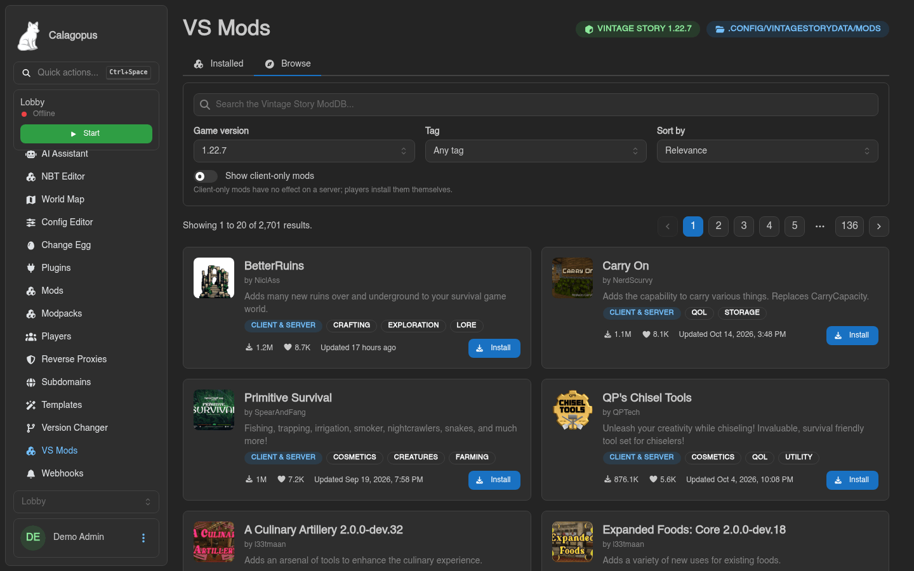
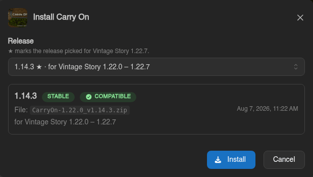
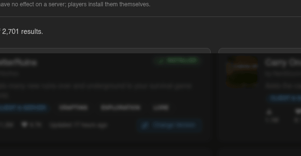
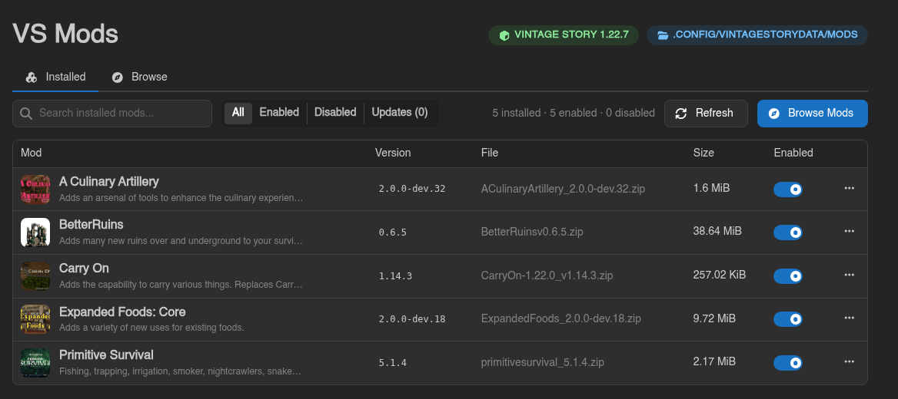

# VS Mod Installer

A [Calagopus Panel](https://calagopus.com) extension that makes installing and managing Vintage Story
mods easy. Browse the official [Vintage Story ModDB](https://mods.vintagestory.at), install mods with one
click and manage everything in the server's `Mods` folder, all from the server's **VS Mods** page. The
Vintage Story sibling of [MC Mod Installer](https://github.com/Caloptreyx/MC-Mod-Installer).

Package name: `dev.caloptreyx.vsmodinstaller` · Requires panel `>=1.2.10`

## Features

- **Browse** the ModDB with search, tag and game version filters, sorting (relevance, downloads,
  follows, trending, recently updated, newest) and a toggle for client-only mods, which are hidden by
  default because a server can't use them. The game version filter starts at the server's version.
- **Mod Details page** with the description (ModDB HTML, sanitized), screenshots, links and a
  **Releases** tab: every release with its game versions, channel and how well it fits the server,
  with search and filters.
- **Install Mod modal**: picks the newest release made for the server's game version (stable before
  pre-release, then the same major version, then the newest at all) and warns, without blocking, when
  the chosen release isn't made for the server's version or only runs on the client.
- **Dependencies**: after an install, the mod's `modinfo.json` dependencies are checked against the
  installed mods. Missing or outdated ones are offered from the ModDB with one click each; anything
  that can't be resolved (not on the ModDB, no release, too new for the game) is listed with the
  reason. One level deep; the game's own `game`, `survival` and `creative` mods are skipped. The
  installed list also flags mods with unmet dependencies.
- **Manage installed mods**: every `.zip`, `.dll`, `.cs` and folder mod in the Mods folder, named by
  its `modinfo.json` (mod id, version, name, authors, side, dependencies) and matched to the ModDB by
  mod id. Shows **update available** for the release that fits the game version; update replaces
  the old file only after the new one has downloaded, and warns with the file name if the old file
  can't be removed (the new one stays installed).
- **Enable or disable** a mod with one switch. Disabled mods are renamed to `<file>.disabled`;
  Vintage Story only loads `.zip`, `.dll` and `.cs` files (checked in its `ModLoader`), so it skips
  them. Updates keep the old file's enabled state. Folder mods can't be disabled this way.
- **Detection badges** show the detected game version and Mods folder; hover a badge to see where
  the value came from. An alert appears when something can't be detected.

## Screenshots

**Browse**: the ModDB filtered to the detected game version.



**Install Mod modal**: the release picked for the server's game version.



**Dependencies**: missing dependencies offered after an install.



**Installed**: the mods in the Mods folder with versions and enable switches.



## Installation

Download `dev_caloptreyx_vsmodinstaller.c7s.zip` from the
[latest release](https://github.com/Caloptreyx/VS-Mod-Installer/releases/latest). Then either upload it
under **Admin → Extensions**, or put it in your heavy image's `build/extensions/` directory and run
`docker compose restart web`. Extensions require the `:heavy` panel image (or a dev environment); see the
[Calagopus docs](https://calagopus.com/docs/panel/extensions/installing-extensions).

No configuration is needed. The **VS Mods** page appears in the sidebar of every server the user may
read files on (the panel's route API has no per-server visibility); on servers that aren't Vintage
Story it only shows a notice and every endpoint refuses with `409`. To hide it for other eggs, use
the egg configuration's route order.

## How detection works

Everything is read through the panel's file access (Wings) as the acting user sees it, so subuser
ignored files stay hidden.

**Vintage Story server**: one of `VintagestoryServer.dll`, `VintagestoryServer`,
`VintagestoryAPI.dll`, `VintagestoryLib.dll` in the server root, else `vintagestory` in the startup
command, else "Vintage Story" (or `vintagestory`, `vintage_story`, `vintage-story`) in the egg, nest
or Docker image name. An admin can replace this with a list of eggs (see below).

**Data path**: `--dataPath` from the startup command (startup variables substituted, quotes and
`--dataPath=` handled, absolute `/home/container/...` paths made relative), else the game's default
`~/.config/VintagestoryData`, which is `.config/VintagestoryData` in the server root. The Caloptreyx
egg and the common Pterodactyl/Pelican eggs pass `--dataPath`, typically `/home/container/data`.

**Mods folder**: the first entry of `ModPaths` in `<dataPath>/serverconfig.json` that lies inside the
server files and isn't the binaries' own `Mods` folder (which holds the game's `VSEssentials.dll` and
co.), else `<dataPath>/Mods`, the game's default. The folder is created on the first install.

**Game version**, in this order:

1. `VintagestoryAPI.dll` in the server root: the assembly version in its version resource
   (`1.22.7.0`) is the game version of the installed binaries, when it matches the API version in
   `FileVersion` (`1.22.0`); 1.21 builds carry a constant `1.0.0.0` and are skipped. It has no
   pre-release suffix, so a `.vs-version` or log version with the same `major.minor.patch` refines
   it (`1.23.0-rc.2`).
2. `.vs-version` in the server root, written by the Caloptreyx Vintage Story egg's installer.
3. `Game Version: v1.22.7 (Stable)` in `<dataPath>/Logs/server-main.log` (or in `--logPath`),
   logged on every start.
4. A startup variable such as `VS_VERSION` or `GAME_VERSION` holding a concrete version.

The binaries come first because a log from before an update would be stale. Reading the DLL, the
config and the log needs `files.read-content`; without it the version stays unknown and the user
picks it.

## Supported versions

Any Vintage Story `1.x` server: versions are compared as `major.minor.patch` with `-dev.N`, `-pre.N`
and `-rc.N` pre-releases, the format of the game and the ModDB. Detection was written against the
1.22.7 server (file layout, `ModLoader`, log line, DLL version resource).

## ModDB API used

Public API v1 at `https://mods.vintagestory.at/api`, no key. All requests come from the panel, with a
`User-Agent` naming this extension; the browser only loads mod logos and screenshots from the ModDB.

| Endpoint | Used for | Cached |
| --- | --- | --- |
| `GET /api/mods` | the whole catalogue (about 10,000 mods, 4 MB): search, tag filter, sorting and paging happen in the panel, so typing never reaches the ModDB | 10 min, one request at a time; the old list is served if a refresh fails |
| `GET /api/mods?gv=<version>` | which mods have a release for a game version | 10 min |
| `GET /api/mod/<id or modid>` | description and releases (`mainfile`, `filename`, `modversion`, game version `tags`, `created`) | 5 min, unknown mods too |
| `GET /api/gameversions` | the game version filter | 1 hour |
| `GET /api/updates?mods=<modid>@<version>,...` | which installed mods have any newer release (40 per request); only those are looked up in full | 5 min |

The API answers unknown mods with `200 OK` and `"statuscode": "404"` in the body. Tags come from the
catalogue itself, so `/api/tags` isn't needed.

## Permissions

The extension uses the panel's existing file permissions:

| Action | Permission |
| --- | --- |
| View the VS Mods pages | `files.read` (`files.read-content` is also needed to read `modinfo.json`, the game version and `serverconfig.json`) |
| Install a mod or a dependency | `files.create` |
| Enable / disable a mod | `files.update` |
| Update or switch a mod's version | `files.create` and `files.delete` |
| Delete a mod | `files.delete` |

Installs go through the panel's file pull endpoint (Wings downloads the ModDB file itself, under its
original file name); renames and deletions use the panel's rename and delete endpoints. So they respect
subuser ignored files and appear in the server's activity log. The extension's own endpoints only read.

## Admin settings

**Admin → Extensions → VS Mod Installer** (`extensions.read` / `extensions.manage`):

- **Eggs**: only servers of these eggs get the mod installer (empty: every server detected as Vintage
  Story).
- **Largest mod archive read**: Wings opens `.zip` files as folders, so enabled mods only read their
  `modinfo.json`. Disabled mods (`.zip.disabled`) can't be opened that way, and Wings won't serve an
  archive as file contents, so their archive is downloaded in full from the node (single-use token,
  like the panel's file download) up to this size (default 64 MiB). Results are cached per file
  size and modification time.

## Limits

- `modinfo.json` is read the way the game reads it with Newtonsoft.Json: property names in any case,
  `//` and `/* */` comments, trailing commas, single quotes and unquoted names. Code-only mods
  (`.dll`, `.cs`) without a manifest are listed by file name; the game reads their `[ModInfo]`
  attribute, which needs a .NET metadata reader.
- Dependencies are resolved one level deep; install the next level from the dependencies list of the
  newly installed mod.
- A mod is matched to the ModDB by its mod id (`modidstrs`); mods published elsewhere show as not on
  the ModDB.
- The version is detected once per 20 seconds per server and user; restart the server or wait after
  an update.

## Development

This repository uses the extension's development layout (`Cargo.toml`, `Metadata.toml`, `src/`,
`frontend/`). Symlink it into a panel checkout as `backend-extensions/dev_caloptreyx_vsmodinstaller`
(and `frontend/` as `frontend/extensions/dev_caloptreyx_vsmodinstaller`), then run from the panel root:

```bash
SQLX_OFFLINE=true cargo test -p dev_caloptreyx_vsmodinstaller
cd frontend && ./node_modules/.bin/tsc && ./node_modules/.bin/oxlint extensions/dev_caloptreyx_vsmodinstaller && ./node_modules/.bin/oxfmt --check extensions/dev_caloptreyx_vsmodinstaller && cd ..
SQLX_OFFLINE=true panel-rs extensions export dev.caloptreyx.vsmodinstaller   # -> exported-extensions/
```

`node --test "tests/*.test.ts"` runs the frontend tests; `python3 scripts/package.py` builds
`dist/dev_caloptreyx_vsmodinstaller.c7s.zip` for installing by hand. CI (`check.yml`) runs all of
this against the latest panel release.

- Backend (`src/`): `GET /api/client/servers/{server}/vs-mod-installer/environment` (detection),
  `moddb/search`, `moddb/filters`, `moddb/mod`, `mods` (the Mods folder with each mod's
  `modinfo.json`), `mods/updates`, `mods/dependencies`. Detection, release selection, `modinfo.json`
  and ZIP reading, and dependency checks are pure, unit-tested modules (`detect.rs`, `versions.rs`,
  `modinfo.rs`, `json.rs`, `zip.rs`, `deps.rs`) with recorded ModDB responses in `tests/fixtures/`.
- Frontend (`frontend/src/`): the pages, and the file changes through the panel's own endpoints.

## License

[MIT](LICENSE)
